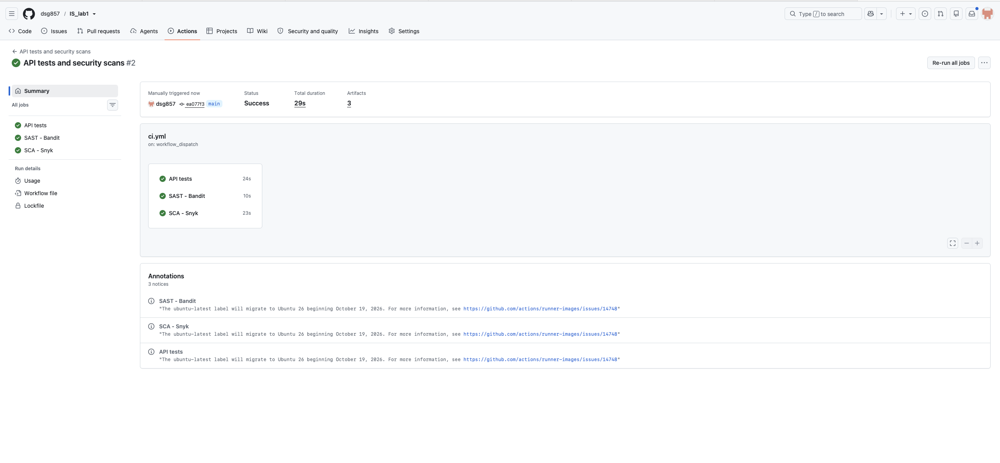

# Work 1 — Secure REST API Development with CI/CD and Real CVE Vulnerability Analysis

A small notes API written with Flask and SQLite, protected with parameterised
SQL, output escaping, bcrypt password hashing and short-lived JWTs. The
repository also contains the GitHub Actions pipeline that tests the API and runs
SAST and SCA on every push, and an analysis of a real vulnerability
(**CVE-2021-35042**) that was reproduced, explained, fixed and re-tested in a
Vulhub environment.

| | |
| --- | --- |
| Repository | <https://github.com/dsg857/IS_lab1> |
| Pipeline run used as evidence | <https://github.com/dsg857/IS_lab1/actions/runs/39240182883> |
| All runs, newest first | <https://github.com/dsg857/IS_lab1/actions/workflows/ci.yml> |
| Vulnerability | CVE-2021-35042 (Django `QuerySet.order_by()` SQL injection) |

## Repository layout

```
.
├── app.py                     # the Flask API
├── tests/test_api.py          # 30 API and security tests
├── requirements.txt           # runtime dependencies
├── requirements-dev.txt       # runtime + test/scanning dependencies
├── .github/workflows/ci.yml   # API tests, Bandit (SAST), Snyk (SCA)
├── docs/
│   ├── api/                   # curl evidence for the API
│   ├── ci/                    # CI screenshot and downloaded scan reports
│   └── cve/                   # reproduction and fix evidence
├── cve/
│   ├── README.md              # CVE analysis in detail
│   └── fix/                   # changed source and configuration files
└── README.md
```

`work1/` (the local virtual environment), `vulhub/` (the upstream lab checkout),
`instance/` (the local database) and `reports/` are excluded from Git.

## 1. The API

### Endpoints

| Method | Path | Authentication | Purpose |
| --- | --- | --- | --- |
| `POST` | `/auth/login` | none | Accept `login` and `password`, return a JWT |
| `GET` | `/api/data` | Bearer JWT | List the current user's notes |
| `POST` | `/api/data` | Bearer JWT | Create a note from a JSON `content` field |

`POST /api/data` is the third method chosen for the assignment: it makes the
protected resource writable, so the data endpoint can be exercised end to end
rather than only read.

### Running locally

Python 3.10 or newer is required:

```bash
source work1/bin/activate                 # existing local virtual environment
python -m pip install -r requirements-dev.txt
export JWT_SECRET_KEY="$(python -c 'import secrets; print(secrets.token_hex(32))')"
python -m flask --app app init-db --login alice   # prompts for a password
python -m flask --app app run --host 127.0.0.1 --port 5001
```

Passwords must be 8–72 UTF-8 bytes; the database is written to
`instance/app.sqlite3`. A new `JWT_SECRET_KEY` invalidates previously issued
tokens, and the application refuses to start without a secret of at least 32
bytes.

### Example session

```bash
# 1. No token: rejected
curl -i http://127.0.0.1:5001/api/data
# HTTP/1.1 401 {"error":"A Bearer token is required."}

# 2. Log in
curl -sS http://127.0.0.1:5001/auth/login \
  -H 'Content-Type: application/json' \
  -d '{"login":"alice","password":"YOUR_PASSWORD"}'
# {"access_token":"…","expires_in":1800}

TOKEN='PASTE_ACCESS_TOKEN_HERE'

# 3. Create a note
curl -i http://127.0.0.1:5001/api/data \
  -H "Authorization: Bearer $TOKEN" \
  -H 'Content-Type: application/json' \
  -d '{"content":"My first secure note"}'
# HTTP/1.1 201

# 4. Read only this user's notes
curl -i http://127.0.0.1:5001/api/data -H "Authorization: Bearer $TOKEN"
# HTTP/1.1 200 {"data":[…]}
```

Screenshots of the same checks are in `docs/api/`:

| Evidence | Result |
| --- | --- |
| [`01-no-token-401.png`](docs/api/01-no-token-401.png) | access without a token denied |
| [`02-login-200.png`](docs/api/02-login-200.png) | login returns a JWT |
| [`03-xss-escaped-201.png`](docs/api/03-xss-escaped-201.png) | `<script>` stored and returned escaped |

The token visible in the login screenshot expired 30 minutes after it was
issued, and the signing key lives only in the environment, not in the
repository.

Invalid credentials and invalid tokens return `401`; malformed JSON or fields
return `400`; bodies over 16 KiB return `413`; notes must be non-blank and at
most 1000 characters.

## 2. Security measures

### SQL injection

Every query that contains user input uses SQLite `?` placeholders with the input
passed as a separate parameter tuple — for example:

```python
user = get_db().execute(
    "SELECT login, password_hash FROM users WHERE login = ?", (username,)
).fetchone()
```

No input is concatenated or interpolated into SQL, and the note queries are also
restricted to the authenticated user's `id`.

### XSS

Note content is stored as text and escaped on output with MarkupSafe's
`escape()`, so `<script>…</script>` is returned as `&lt;script&gt;…`. Both note
endpoints answer with `jsonify()`, i.e. `Content-Type: application/json`, and
every response carries `X-Content-Type-Options: nosniff`. A future frontend
should render values with `textContent`, never `innerHTML`.

### Authentication and password storage

- Passwords are stored only as salted bcrypt hashes (cost 12), never in plain
  text.
- Login issues a 30-minute HS256 JWT containing `sub`, `iat` and `exp`.
- A shared `login_required` decorator protects the data endpoints: it fixes the
  accepted algorithm, requires the three claims, verifies the signature and
  expiry, and checks that the user still exists.
- The signing secret comes from the `JWT_SECRET_KEY` environment variable, must
  be at least 32 bytes and has no default.

### Configuration and access control

Notes are always filtered by the authenticated user's ID, the database and
secrets are excluded from Git, and the API never runs with debug mode enabled in
the provided run command.

## 3. CI/CD with SAST and SCA

`.github/workflows/ci.yml` runs automatically on every push and pull request and
can also be started manually from **Actions → API tests and security scans →
Run workflow**. Three independent jobs run on Ubuntu with Python 3.10:

| Job | What it checks | Artifact |
| --- | --- | --- |
| **API tests** | authentication, data access and the security behaviour | `api-test-report` (`pytest.xml`) |
| **SAST — Bandit** | the application source (`app.py`) | `bandit-sast-report` (`bandit.json`) |
| **SCA — Snyk** | known vulnerabilities in runtime, development and transitive dependencies | `snyk-sca-report` (`snyk.json`) |

A failing test, a Bandit finding, a Snyk vulnerability or a scanner error makes
the corresponding job fail; the other jobs still run, and reports are uploaded
with `always()` so evidence is kept even for a failing run. Actions are pinned
to commit hashes and the Snyk CLI to `1.1308.1`.

The successful run used as evidence is
[run #2](https://github.com/dsg857/IS_lab1/actions/runs/39240182883) on commit
`ea077f3`:



All three jobs are green and all three artifacts are present. The downloaded
reports are committed under `docs/ci/`:

- `pytest.xml` — 30 tests, 0 failures, 0 errors
- `bandit.json` — 0 findings (no checks suppressed)
- `snyk.json` — `"ok": true`, 23 dependencies, 0 vulnerabilities

The SCA job needs a `SNYK_TOKEN` repository secret (**Settings → Secrets and
variables → Actions**). Without it the job fails with an explicit setup message
instead of pretending to pass.

## 4. CVE analysis: CVE-2021-35042

The full analysis, with every command and screenshot, is in
[`cve/README.md`](cve/README.md). The summary follows.

### 4.1 Vulnerability

Django 3.2.x before 3.2.5 and 3.1.x before 3.1.13 allow SQL injection through
`QuerySet.order_by()` when untrusted input is passed as the ordering argument.
CVSS 3.1 score **9.8 (Critical)**; the flaw is unauthenticated and needs only one
request. It is a realistic bug for this assignment because the API also deals
with authentication and SQL, and because it shows the one place where
parameterised queries cannot help.

### 4.2 Environment

The Vulhub lab `django/CVE-2021-35042` (Django 3.2.4, MySQL 5.7.44) was started
with `docker compose up -d`; the images are `linux/amd64` only, so
`platform: linux/amd64` was added to both services and the containers ran through
Rosetta emulation on the Apple Silicon host.


The sort parameter works normally before the attack (`?order=-id` returns the
rows in descending order), which is later reused as the regression test:


### 4.3 Reproduction

The view passes the raw parameter to the ORM, so the following unauthenticated
request is enough:

```bash
curl -s -G 'http://127.0.0.1:8000/vuln/' \
  --data-urlencode "order=vuln_collection.name);select updatexml(1, concat(0x7e,(select @@version)),1)#"
```

The response is `HTTP 500` with `(1105, "XPATH syntax error: '~5.7.44'")`: the
closing parenthesis ends the `ORDER BY` expression, `#` comments out the rest of
the statement, and `updatexml()` reflects the subquery result in its error
message, disclosing the database version without any credentials.


### 4.4 Root cause

`ORDER BY` cannot be parameterised — placeholders bind values, while the ordering
target is an identifier or expression resolved by the database at parse time.
Django 3.2.4 had a deprecation shortcut in `Query.add_ordering()`: a string
containing a dot was assumed to be a raw column alias, so validation was skipped
and `SQLCompiler.get_order_by()` passed the remainder verbatim into `RawSQL()`,
quoting only the table prefix. The view then supplied user input as that string,
so attacker-controlled SQL syntax reached the generated statement. Django 3.2.5
restored strict validation: only strings matching `[-+]?[.\w]+$` may take the
raw-alias path; everything else is resolved as a field name and raises
`FieldError` before SQL is built.

### 4.5 Fix

`vuln/views.py` no longer forwards the raw parameter. It parses an optional
leading `-`, validates the remaining field name against `{'id', 'name'}`, returns
`400` otherwise, and rebuilds the ordering string from the validated value. The
attacker can only choose one of two columns and the direction; no part of the
SQL expression is under their control. The changed files are in
[`cve/fix/`](cve/fix/) with a unified diff in
[`cve/fix/patch.diff`](cve/fix/patch.diff).

### 4.6 Verification

The same request against the fixed version returns `400 Invalid order
parameter.`; normal ordering, the default page and `?order=name` still work. Five
alternative payloads (`name);select 1#`, `(select 1)`, `name--`, `id DESC`,
`Name`) are all rejected with `400`, which confirms the check is an allowlist
rather than a keyword filter.


## 5. Local verification

| Check | Result |
| --- | --- |
| `python -m pytest -q` | 30 tests passed (login, hashing, both protected endpoints, invalid/expired/forged tokens, SQL-injection inputs, XSS escaping, user isolation, invalid input) |
| `python -m bandit app.py -f json` | 0 findings, no checks suppressed |
| Real `curl` checks | 6 checks passed: login, authenticated create/read, missing/invalid tokens, escaped script content |

## 6. Evidence index

| Assignment requirement | Evidence |
| --- | --- |
| API description and call examples | §1 of this README, `docs/api/` |
| Security measures | §2, `tests/test_api.py` |
| SAST/SCA screenshots | [`docs/ci/actions-run-2-success.png`](docs/ci/actions-run-2-success.png) |
| CVE ID and description | §4.1, [`cve/README.md`](cve/README.md) |
| Reproduction commands and screenshots | §4.3, `docs/cve/01`–`03` |
| Root cause | §4.4, `cve/README.md` |
| Applied fix | §4.5, [`cve/fix/`](cve/fix/) |
| Proof of elimination | §4.6, `docs/cve/04`–`06` |
| Successful pipeline run | <https://github.com/dsg857/IS_lab1/actions/runs/39240182883> |

## 7. Assignment checklist

| Requirement | Status |
| --- | --- |
| Chosen stack, project and local Git repository | Done |
| Login, protected data and a third method | Done |
| Parameterised SQL, XSS escaping, JWT and password hashing | Done |
| API tests and curl instructions | Done |
| Public remote repository | Done — <https://github.com/dsg857/IS_lab1> |
| CI on push/PR with SAST and SCA and report artifacts | Done — 3 jobs, run #2 green |
| Screenshots of the successful SAST/SCA run | Done — `docs/ci/` |
| Select and launch a Vulhub CVE | Done — CVE-2021-35042 |
| Reproduce, explain the root cause, apply and verify the fix | Done — `cve/` |
| Final report | Prepared separately from this README |

## References

- OWASP Top 10 — <https://owasp.org/www-project-top-ten/>
- OWASP SQL injection prevention —
  <https://cheatsheetseries.owasp.org/cheatsheets/SQL_Injection_Prevention_Cheat_Sheet.html>
- OWASP XSS prevention —
  <https://cheatsheetseries.owasp.org/cheatsheets/Cross_Site_Scripting_Prevention_Cheat_Sheet.html>
- Flask security — <https://flask.palletsprojects.com/en/stable/web-security/>
- PyJWT usage — <https://pyjwt.readthedocs.io/en/stable/usage.html>
- GitHub Actions — <https://docs.github.com/en/actions>
- Vulhub — <https://github.com/vulhub/vulhub>
- NVD, CVE-2021-35042 — <https://nvd.nist.gov/vuln/detail/CVE-2021-35042>
- Django security release, 1 July 2021 —
  <https://www.djangoproject.com/weblog/2021/jul/01/security-releases/>
